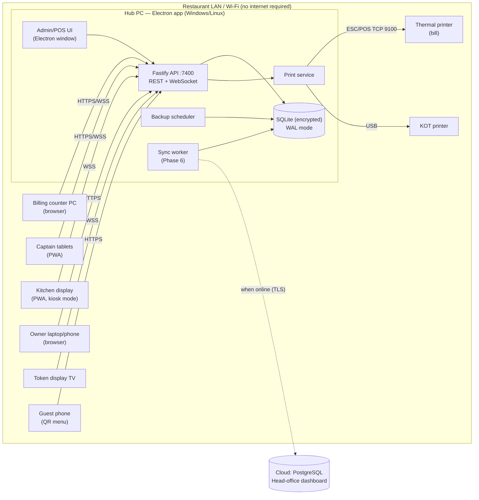
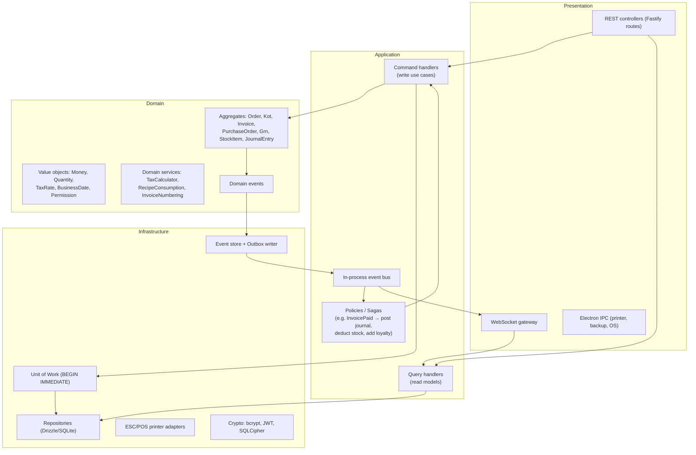

# 01 — System Architecture

> Status: **Draft for review** · Phase 0 (Planning) · Owner: Engineering

## 1. Goals and constraints

| Driver | Consequence for the design |
|---|---|
| Restaurant must never stop when the internet is down | Everything (auth, ordering, KDS, billing, printing, reports) runs on a **local server inside the restaurant**. The cloud is optional and asynchronous. |
| Many devices on the same LAN (POS PC, captain tablets, KDS screens, owner laptop) | One machine is the **Hub** (Electron app with an embedded HTTP + WebSocket server). Every other device is a thin **browser/PWA client** — no install required on tablets. |
| Low hardware cost | A single Windows/Linux PC (4 GB RAM, SSD) must handle the whole branch. SQLite in WAL mode, a Node.js process, no external services. |
| Legal records (GST invoices, audit) | Append-only ledgers, gapless invoice numbering, hash-chained audit log, nothing physically deleted. |
| Future cloud / multi-branch / franchise | UUIDv7 keys, `version` columns, a domain event log and a transactional outbox (`sync_queue`) exist from day 1, even though the cloud is built in Phase 6. |

### Non-functional targets and how they're met

| Target | Approach |
|---|---|
| 100+ concurrent users per branch | Fastify handles thousands of req/s on one core. SQLite WAL allows unlimited concurrent readers plus one writer. Writes are short (< 5 ms) transactions. |
| 50,000 orders/day (~0.6/s average, ~10/s peak) | Well inside a single SQLite writer (> 1,000 write txns/s on SSD). Prepared statements, covering indexes, and no ORM N+1 queries. |
| 1M+ transactions/year | ~2–4 GB/year. Daily rollups (`v_daily_sales` → materialized summary tables in Phase 5) keep dashboards fast. Yearly archive file per fiscal year if needed. |
| < 500 ms response | p95 budget: API < 50 ms, WebSocket push < 100 ms on LAN. React Query caches; optimistic UI on captain/KDS actions. |
| Real-time order sync | Domain events are published on an in-process bus, then pushed to clients over WebSocket rooms (`branch:{id}:kds:{station}`, `…:floor`, `…:pos`). |
| 99.9% uptime | Hub auto-starts as an OS service, watchdog restarts on crash, WAL + `synchronous=NORMAL`, hourly hot backups, and a documented **Standby Hub** fail-over (Phase 6). |

## 2. Technology decisions

The recommended **Electron + React + Node.js + SQLite + LAN server** stack is adopted. Each decision is recorded as an ADR in [`docs/adr`](./adr).

| Layer | Choice | Why |
|---|---|---|
| Language | **TypeScript** (strict) everywhere | One language for the server, clients, shared domain, and tests. Shared types/validators between API and UI. |
| Desktop shell | **Electron** | Windows + Linux installers, auto-start, tray icon, direct USB/serial printer access, auto-update. |
| HTTP server | **Fastify 5** | Fast, schema-first (JSON Schema/Zod), first-class plugins and DI-friendly lifecycle. |
| Realtime | **WebSocket** (`@fastify/websocket`) with a typed event protocol | No extra broker; works on LAN without internet. |
| Database | **SQLite 3.45+** via `better-sqlite3-multiple-ciphers` (SQLCipher-compatible) | Synchronous, fastest Node driver, true ACID, **encrypted at rest**. |
| Query layer | **Drizzle ORM** (+ raw SQL for reports) | Typed schema that targets SQLite **and** PostgreSQL/MySQL, so migrating dialects later is a config change, not a rewrite. |
| Validation | **Zod** | Shared request/response contracts in `packages/contracts`. |
| Frontend | **React 19 + Vite + TailwindCSS 4 + shadcn/ui + Framer Motion** | Requested stack; shadcn gives accessible primitives we own. |
| Client state | **TanStack Query** (server state) + **Zustand** (UI/cart state) | Clear split: cache vs. local interaction state. |
| Offline on clients | **PWA** (Workbox) + IndexedDB queue for the captain app | A tablet that briefly loses Wi-Fi keeps taking orders and replays them. |
| Auth | **JWT access token (15 min) + rotating refresh token (12 h shift)**, **bcrypt** (cost 12), PIN quick-switch | Requested; refresh-token families detect token theft. |
| Printing | ESC/POS via `node-thermal-printer` (network/USB) + OS print spooler fallback | Covers thermal, POS, and USB printers. |
| Discovery | **mDNS/DNS-SD** (`_restroos._tcp`) + QR pairing code | See §6 on Bluetooth. |
| Reports export | `pdfmake` (PDF), `exceljs` (XLSX), streaming CSV | Pure JS, works offline. |
| Tests | Vitest (unit), Supertest-style Fastify `inject` (integration), Playwright (E2E) | |
| Monorepo | **pnpm workspaces + Turborepo** | Shared packages, cached builds. |

> **.NET alternative**: not chosen. It would split the codebase into two languages and lose shared validation contracts with the React UI. The Clean Architecture boundaries below would still allow porting the server to ASP.NET Core later if a customer requires it.

## 3. Deployment topology (single branch)



- The Hub binds to `0.0.0.0:7400` and serves the **React SPA plus the API from the same origin**, so tablets just open `https://restro.local:7400`.
- TLS on LAN: the Hub generates a local CA at first run. Devices trust it once during pairing (QR code). Plain HTTP is allowed only on `localhost`.
- Guest QR ordering uses a separate, rate-limited, unauthenticated route group (`/public/qr/*`) that can only create `QR_SELF` orders in `PENDING_APPROVAL` for a captain to confirm.

## 4. Logical architecture (Clean Architecture + DDD + CQRS)



**Dependency rule**: `domain` imports nothing. `application` imports `domain` and **ports** (interfaces). `infrastructure` implements the ports. `presentation` wires them together through the DI container (`awilix`). This keeps the domain testable without a database and makes a PostgreSQL adapter a drop-in replacement.

### Bounded contexts (modules)

| Context | Aggregates | Phase |
|---|---|---|
| **Identity & Access** | User, Role, Session | 1 |
| **Catalog** | MenuItem, Category, AddonGroup, TaxGroup | 1 |
| **Floor** | DiningTable, Reservation | 1 |
| **Ordering** | Order (with OrderItems) | 1 |
| **Kitchen** | Kot | 1 |
| **Billing** | Invoice, Payment, CashShift | 1 |
| **CRM** | Customer, LoyaltyAccount | 1 (basic) / 5 |
| **Inventory** | StockItem, Recipe, StockCount | 2 |
| **Purchasing** | Vendor, PurchaseOrder, Grn, VendorPayment | 3 |
| **Accounting** | Account, JournalEntry, Expense | 4 |
| **Reporting** | read models only | 5 |
| **Sync** | SyncQueue, Conflict | 6 |
| **Intelligence** | forecasts (read-only consumers of events) | 7 |

Contexts talk to each other **only through domain events**. For example, Inventory never queries `orders`; it reacts to `KotFired` / `OrderItemCancelled`. That decoupling is what lets Phase 2+ modules be added without touching Phase 1 code.

### CQRS in practice

- **Commands** (`FireKot`, `GenerateInvoice`, `RecordPayment`) run in one `BEGIN IMMEDIATE` transaction:
  1. load aggregate(s) → 2. check permission and invariants → 3. mutate → 4. persist with `version` check → 5. append `domain_events` + `audit_logs` + `sync_queue` → `COMMIT` → 6. publish events in-process (after commit).
- **Queries** read the same DB through dedicated read repositories and SQL views (no aggregates loaded). If dashboards outgrow the views, Phase 5 adds projection tables that event handlers maintain.
- Event sourcing is **hybrid**: current state lives in normal tables (simple queries, easy reports), and every change is also recorded as an immutable event (audit, sync, replay, AI training data). Full event-sourced rebuild isn't required, but it's possible for Ordering/Kitchen.

## 5. Key cross-cutting designs

### 5.1 Transactions and inventory locking
SQLite has a single writer, which is an advantage here: `BEGIN IMMEDIATE` takes the write lock up front, so two cashiers can never both deduct the last 150 g of chicken. Inside the transaction, `inventory_stock.version` is still checked so the same code is correct on PostgreSQL (where it becomes `SELECT … FOR UPDATE`). `busy_timeout = 5000` absorbs contention.

### 5.2 Money, tax, rounding
- `Money` is an integer of minor units with currency. All arithmetic lives in `packages/domain/money`.
- Tax is computed **per line** (GST requires HSN-wise breakup), then summed. CGST/SGST vs. IGST is chosen from branch `state_code` vs. place of supply.
- Rounding: line tax uses banker's rounding to the minor unit. The bill total is rounded to the nearest whole rupee and stored separately in `round_off`.

### 5.3 Numbering
- `order_no`, `kot_no`, `token_no` reset daily per branch.
- `invoice_no` is **gapless per branch per fiscal year** (`document_sequences`, incremented inside the invoice transaction). Cancelled invoices keep their number with status `CANCELLED`.

### 5.4 Security model
- **RBAC**: permissions (52 seeded) → roles → users, scoped **per branch** (`user_roles.branch_id`). Every route declares `requires: ['billing.refund']`. A Fastify `preHandler` enforces it, and the UI hides what the user can't do.
- **Manager override**: sensitive actions (refund, void after KOT, discount above limit) accept an `X-Approver-Token` obtained by a manager entering their PIN on the same device. Both actor and approver are written to `audit_logs`.
- **Audit**: hash-chained (`hash = SHA256(prev_hash || canonical_json(row))`). A nightly job verifies the chain and raises a CRITICAL notification on mismatch.
- **Soft delete**: DB triggers physically block `DELETE` on business tables (see schema §13).
- **At rest**: SQLCipher (AES-256). The key is derived from a machine-bound secret stored in the OS keychain (Windows DPAPI / libsecret). Backups are encrypted with AES-256-GCM using a separate backup passphrase.
- **In transit**: TLS on LAN with a local CA. Rate limiting and lockout after 5 failed logins.
- **Tokens**: access JWT (EdDSA, 15 min) in memory; refresh token is opaque, hashed in DB, rotated on use, and reuse revokes the family.

### 5.5 Backups
- Hot backup using the SQLite Online Backup API every hour + at end-of-day, retained 7 hourly / 30 daily / 12 monthly.
- Copy to a secondary target (USB drive / NAS path / cloud bucket when online).
- One-click restore with integrity check and a `PRE_MIGRATION` backup before every schema migration.

### 5.6 Synchronization (designed now, built in Phase 6)

```
command txn ─► domain_events (seq) ─► sync_queue (PENDING)
                                         │ worker (when online)
                                         ▼
                           POST /sync/push (batch, idempotent by event id)
                                         │
                       cloud applies events ─► head-office read models
                                         │
                           GET /sync/pull?cursor=… (menu, prices, config)
```

- **Idempotency**: the event `id` (UUIDv7) is the dedupe key in the cloud.
- **Retry**: exponential backoff (1 s → 2 s → … capped at 15 min) with jitter. Status `FAILED` after 20 attempts surfaces in the admin UI.
- **Conflict resolution**: transactional data (orders, invoices, payments, stock movements) is **branch-owned and append-only**, so it can't conflict. Master data (menu, prices, tax) is **HQ-owned**: the cloud wins and the local change is rejected into `sync_conflicts`. Branch-editable master data (e.g. item availability) uses last-writer-wins on `version` + `updated_at` and logs a conflict for manual review.

### 5.7 AI readiness (Phase 7, not implemented)
The `domain_events` stream plus daily summary tables are the training and feature source. The `Intelligence` context will subscribe to events and expose read-only endpoints (`/ai/forecast/demand`, `/ai/inventory/reorder-suggestions`). No other module will depend on it.

## 6. Device discovery and pairing

1. The Hub advertises `_restroos._tcp.local` via mDNS and shows a **pairing QR** (URL + one-time code + CA fingerprint).
2. A tablet scans the QR (or browses to `restro.local`), trusts the CA, and registers as a `device` with a kind (`CAPTAIN`, `KDS`, …).
3. Devices then sign in with username/password or a PIN.

**On Bluetooth**: browsers can't reliably discover services over Bluetooth, and BT bandwidth/range is poor for a POS. Bluetooth is supported **for printers only** (BT thermal printers via the Hub). LAN discovery uses mDNS plus a QR fallback. Please confirm this is acceptable (see open questions).

## 7. Scaling path

| Stage | Topology |
|---|---|
| Single outlet | 1 Hub PC, N browser devices |
| Busy outlet / 99.9% | Hub + **Standby Hub** pulling a WAL-shipped replica (Litestream-style) with manual promote |
| Multi-branch | Each branch has its own Hub (offline-first) and syncs to the cloud. HQ edits the menu centrally and it pulls down. |
| Franchise | `organization` → franchisee; cloud tenancy isolates franchisees, and royalty reports come from synced invoices |
| Cloud-first customers | Same server code against PostgreSQL (Drizzle dialect switch), deployed as a container |

## 8. Open questions for the product owner

1. **Primary market/tax regime**: India GST only at launch, or also VAT (GCC/UK)? The schema supports both, but receipt formats and reports differ.
2. **E-invoicing (IRN/QR via GST portal)** for B2B bills: needed in Phase 1? It requires internet and would be queued.
3. **Payment terminals**: integrate with specific card/UPI devices (Pine Labs, Paytm EDC, Razorpay POS), or record payments manually in Phase 1?
4. **Bluetooth**: OK to limit Bluetooth to printers (see §6)?
5. **Online aggregators** (Swiggy/Zomato) order ingestion: which phase?
6. **Languages**: UI localisation needed (Hindi, regional languages, Arabic RTL)?
