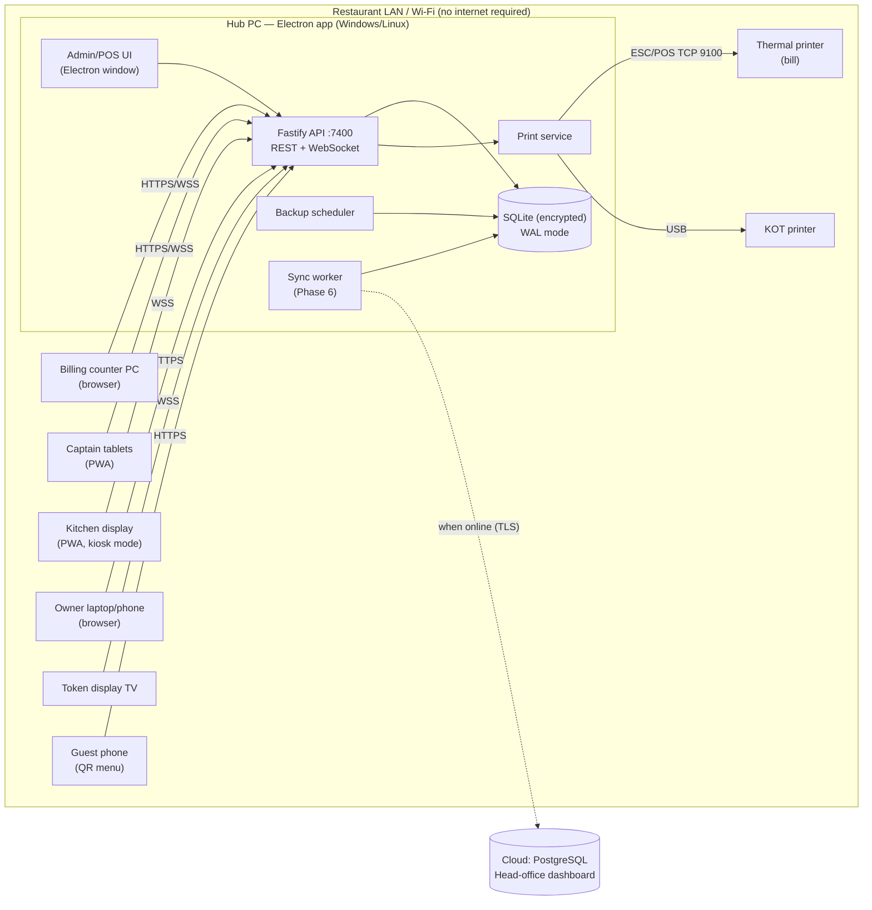
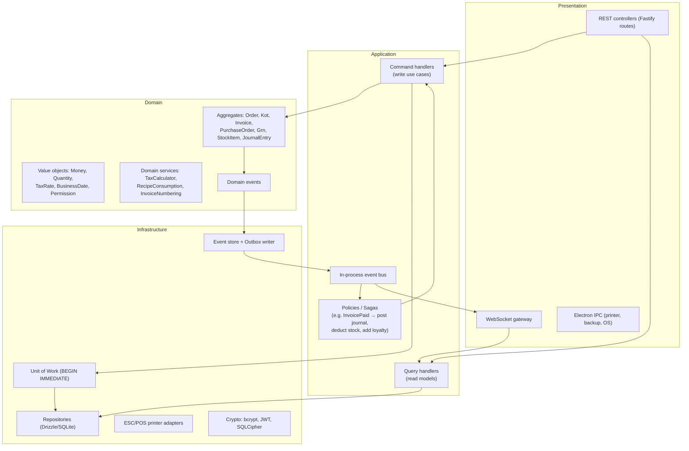

# 01 — System Architecture

> Status: **Draft for review** · Phase 0 (Planning) · Owner: Engineering

## 1. Goals and constraints

| Driver | Consequence for the design |
|---|---|
| Restaurant must never stop when the internet is down | Everything (auth, ordering, KDS, billing, printing, reports) runs on a **local server inside the restaurant**. The cloud is optional and asynchronous. |
| Many devices on the same LAN (POS PC, captain tablets, KDS screens, owner laptop) | One machine is the **Hub** (Electron app with an embedded HTTP + WebSocket server). Every other device is a thin **browser/PWA client** — no install required on tablets. |
| Low hardware cost | A single Windows/Linux PC (4 GB RAM, SSD) must handle the whole branch. SQLite in WAL mode, a Node.js process, no external services. |
| Legal records (GST/VAT invoices, audit) | Append-only ledgers, gapless invoice numbering, hash-chained audit log, nothing physically deleted. |
| Future cloud / multi-branch / franchise | UUIDv7 keys, `version` columns, a domain event log and a transactional outbox (`sync_queue`) exist from day 1, even though the cloud is built in Phase 6. |

### Non-functional targets and how they're met

| Target | Approach |
|---|---|
| 100+ concurrent users per branch | Fastify handles thousands of req/s on one core. SQLite WAL allows unlimited concurrent readers plus one writer. Writes are short (< 5 ms) transactions. |
| 50,000 orders/day (~0.6/s average, ~10/s peak) | Well inside a single SQLite writer (> 1,000 write txns/s on SSD). Prepared statements, covering indexes, and no ORM N+1 queries. |
| 1M+ transactions/year | ~2–4 GB/year. Daily rollups (`v_daily_sales` → materialized summary tables in Phase 5) keep dashboards fast. Yearly archive file per fiscal year if needed. |
| < 500 ms response | p95 budget: API < 50 ms, WebSocket push < 100 ms on LAN. React Query caches; optimistic UI on captain/KDS actions. |
| Real-time order sync | Domain events are published on an in-process bus, then pushed to clients over WebSocket rooms (`branch:{id}:kds:{station}`, `…:floor`, `…:pos`). |
| 99.9% uptime | Hub auto-starts as an OS service, watchdog restarts on crash, WAL + `synchronous=NORMAL`, hourly hot backups, and a documented **Standby Hub** fail-over (Phase 6). |

## 2. Technology decisions

The recommended **Electron + React + Node.js + SQLite + LAN server** stack is adopted. Each decision is recorded as an ADR in [`docs/adr`](./adr).

| Layer | Choice | Why |
|---|---|---|
| Language | **TypeScript** (strict) everywhere | One language for the server, clients, shared domain, and tests. Shared types/validators between API and UI. |
| Desktop shell | **Electron** | Windows + Linux installers, auto-start, tray icon, direct USB/serial printer access, auto-update. |
| HTTP server | **Fastify 5** | Fast, schema-first (JSON Schema/Zod), first-class plugins and DI-friendly lifecycle. |
| Realtime | **WebSocket** (`fastify/websocket`) with a typed event protocol | No extra broker; works on LAN without internet. |
| Database | **SQLite 3.45+** via `better-sqlite3-multiple-ciphers` (SQLCipher-compatible) | Synchronous, fastest Node driver, true ACID, **encrypted at rest**. |
| Query layer | **Drizzle ORM** (+ raw SQL for reports) | Typed schema that targets SQLite **and** PostgreSQL/MySQL, so migrating dialects later is a config change, not a rewrite. |
| Validation | **Zod** | Shared request/response contracts in `packages/contracts`. |
| Frontend | **React 19 + Vite + TailwindCSS 4 + shadcn/ui + Framer Motion** | Requested stack; shadcn gives accessible primitives we own. |
| Client state | **TanStack Query** (server state) + **Zustand** (UI/cart state) | Clear split: cache vs. local interaction state. |
| Offline on clients | **PWA** (Workbox) + IndexedDB queue for the captain app | A tablet that briefly loses Wi-Fi keeps taking orders and replays them. |
| Android tablet app | **Capacitor** Android wrapper around the same React build (Phase 1.5) | Captain and KDS tablets are **Android**. Chrome covers Phase 1. The app adds reliable background Bluetooth reconnection for the Wi-Fi fallback and kiosk lock for KDS screens. See §6. |
| Bluetooth | Hub: BLE GATT server via a small per-OS bridge (Linux BlueZ D-Bus, Windows WinRT `GattServiceProvider`). Clients: Web Bluetooth in Chrome on Android (Phase 1), Capacitor BLE plugin in the Android app (Phase 1.5) | Discovery, pairing, Wi-Fi-down fallback channel, and peripherals. See §6. |
| Internationalisation | **i18next / react-i18next** (ICU messages), `Intl` for numbers/dates, bundled Noto Sans Devanagari + Bengali fonts | English, Hindi, Bengali at launch. See §5.8. |
| Auth | **JWT access token (15 min) + rotating refresh token (12 h shift)**, **bcrypt** (cost 12), PIN quick-switch | Requested; refresh-token families detect token theft. |
| Printing | ESC/POS via `node-thermal-printer` (network/USB) + OS print spooler fallback | Covers thermal, POS, and USB printers. |
| Discovery | **mDNS/DNS-SD** (`_restroos._tcp`) + **BLE advertisement** + QR pairing code | Three independent ways to find the Hub. See §6. |
| Reports export | `pdfmake` (PDF), `exceljs` (XLSX), streaming CSV | Pure JS, works offline. |
| Tests | Vitest (unit), Supertest-style Fastify `inject` (integration), Playwright (E2E) | |
| Monorepo | **pnpm workspaces + Turborepo** | Shared packages, cached builds. |

> **.NET alternative**: not chosen. It would split the codebase into two languages and lose shared validation contracts with the React UI. The Clean Architecture boundaries below would still allow porting the server to ASP.NET Core later if a customer requires it.

## 3. Deployment topology (single branch)



- The Hub binds to `0.0.0.0:7400` and serves the **React SPA plus the API from the same origin**, so tablets just open `https://restro.local:7400`.
- TLS on LAN: the Hub generates a local CA at first run. Devices trust it once during pairing (QR code). Plain HTTP is allowed only on `localhost`.
- Guest QR ordering uses a separate, rate-limited, unauthenticated route group (`/public/qr/*`) that can only create `QR_SELF` orders in `PENDING_APPROVAL` for a captain to confirm.

## 4. Logical architecture (Clean Architecture + DDD + CQRS)



**Dependency rule**: `domain` imports nothing. `application` imports `domain` and **ports** (interfaces). `infrastructure` implements the ports. `presentation` wires them together through the DI container (`awilix`). This keeps the domain testable without a database and makes a PostgreSQL adapter a drop-in replacement.

### Bounded contexts (modules)

| Context | Aggregates | Phase |
|---|---|---|
| **Identity & Access** | User, Role, Session | 1 |
| **Catalog** | MenuItem, Category, AddonGroup, TaxGroup | 1 |
| **Floor** | DiningTable, Reservation | 1 |
| **Ordering** | Order (with OrderItems) | 1 |
| **Kitchen** | Kot | 1 |
| **Billing** | Invoice, Payment, CashShift | 1 |
| **CRM** | Customer, LoyaltyAccount | 1 (basic) / 5 |
| **Inventory** | StockItem, Recipe, StockCount | 2 |
| **Purchasing** | Vendor, PurchaseOrder, Grn, VendorPayment | 3 |
| **Accounting** | Account, JournalEntry, Expense | 4 |
| **Reporting** | read models only | 5 |
| **Sync** | SyncQueue, Conflict | 6 |
| **Intelligence** | forecasts (read-only consumers of events) | 7 |

Contexts talk to each other **only through domain events**. For example, Inventory never queries `orders`; it reacts to `KotFired` / `OrderItemCancelled`. That decoupling is what lets Phase 2+ modules be added without touching Phase 1 code.

### CQRS in practice

- **Commands** (`FireKot`, `GenerateInvoice`, `RecordPayment`) run in one `BEGIN IMMEDIATE` transaction:
  1. load aggregate(s) → 2. check permission and invariants → 3. mutate → 4. persist with `version` check → 5. append `domain_events` + `audit_logs` + `sync_queue` → `COMMIT` → 6. publish events in-process (after commit).
- **Queries** read the same DB through dedicated read repositories and SQL views (no aggregates loaded). If dashboards outgrow the views, Phase 5 adds projection tables that event handlers maintain.
- Event sourcing is **hybrid**: current state lives in normal tables (simple queries, easy reports), and every change is also recorded as an immutable event (audit, sync, replay, AI training data). Full event-sourced rebuild isn't required, but it's possible for Ordering/Kitchen.

## 5. Key cross-cutting designs

### 5.1 Transactions and inventory locking
SQLite has a single writer, which is an advantage here: `BEGIN IMMEDIATE` takes the write lock up front, so two cashiers can never both deduct the last 150 g of chicken. Inside the transaction, `inventory_stock.version` is still checked so the same code is correct on PostgreSQL (where it becomes `SELECT … FOR UPDATE`). `busy_timeout = 5000` absorbs contention.

### 5.2 Money, tax, rounding
- `Money` is an integer number of paise. All arithmetic lives in `packages/domain/shared/money`.
- India only. Each **item's tax group** carries the tax type: **GST** (food and non-alcoholic drinks) or **state VAT** (alcoholic liquor, which is outside GST). The `TaxEngine` has one calculator per type (§5.7).
- Tax is computed **per line**, then summed. GST needs an HSN/SAC-wise breakup, and VAT is reported per rate.
- Rounding: line tax uses banker's rounding to the paisa. The bill total is rounded to the branch's `cash_rounding` (default nearest ₹1) and stored separately in `round_off`.

### 5.3 Numbering
- `order_no`, `kot_no`, `token_no` reset daily per branch.
- `invoice_no` is **gapless per branch per fiscal year** (`document_sequences`, incremented inside the invoice transaction). Cancelled invoices keep their number with status `CANCELLED`.

### 5.4 Security model
- **RBAC**: permissions (52 seeded) → roles → users, scoped **per branch** (`user_roles.branch_id`). Every route declares `requires: ['billing.refund']`. A Fastify `preHandler` enforces it, and the UI hides what the user can't do.
- **Manager override**: sensitive actions (refund, void after KOT, discount above limit) accept an `X-Approver-Token` obtained by a manager entering their PIN on the same device. Both actor and approver are written to `audit_logs`.
- **Audit**: hash-chained (`hash = SHA256(prev_hash || canonical_json(row))`). A nightly job verifies the chain and raises a CRITICAL notification on mismatch.
- **Soft delete**: DB triggers physically block `DELETE` on business tables (see schema §13).
- **At rest**: SQLCipher (AES-256). The key is derived from a machine-bound secret stored in the OS keychain (Windows DPAPI / libsecret). Backups are encrypted with AES-256-GCM using a separate backup passphrase.
- **In transit**: TLS on LAN with a local CA. Rate limiting and lockout after 5 failed logins.
- **Tokens**: access JWT (EdDSA, 15 min) in memory; refresh token is opaque, hashed in DB, rotated on use, and reuse revokes the family.

### 5.5 Backups
- Hot backup using the SQLite Online Backup API every hour + at end-of-day, retained 7 hourly / 30 daily / 12 monthly.
- Copy to a secondary target (USB drive / NAS path / cloud bucket when online).
- One-click restore with integrity check and a `PRE_MIGRATION` backup before every schema migration.

### 5.6 Synchronization (designed now, built in Phase 6)

```
command txn ─► domain_events (seq) ─► sync_queue (PENDING)
                                         │ worker (when online)
                                         ▼
                           POST /sync/push (batch, idempotent by event id)
                                         │
                       cloud applies events ─► head-office read models
                                         │
                           GET /sync/pull?cursor=… (menu, prices, config)
```

- **Idempotency**: the event `id` (UUIDv7) is the dedupe key in the cloud.
- **Retry**: exponential backoff (1 s → 2 s → … capped at 15 min) with jitter. Status `FAILED` after 20 attempts surfaces in the admin UI.
- **Conflict resolution**: transactional data (orders, invoices, payments, stock movements) is **branch-owned and append-only**, so it can't conflict. Master data (menu, prices, tax) is **HQ-owned**: the cloud wins and the local change is rejected into `sync_conflicts`. Branch-editable master data (e.g. item availability) uses last-writer-wins on `version` + `updated_at` and logs a conflict for manual review.

### 5.7 Taxes: GST and liquor VAT
| | GST (`tax_type = GST`) | State VAT (`tax_type = VAT`) |
|---|---|---|
| Applies to | Food, non-alcoholic beverages, service charge | Alcoholic liquor for human consumption (outside GST) |
| Components | CGST + SGST when the place of supply is in the branch's state, else IGST | VAT at the state's rate, plus any state surcharge/cess (`tax_components`) |
| Rates | Configured as data (e.g. 5% for most restaurants, 18% where applicable) | Configured per state, as data |
| Registration printed | Branch GSTIN | Branch VAT TIN + excise licence no. |
| Reports | GSTR-1 / GSTR-3B summaries, HSN summary | State VAT sales register by rate |

**Mixed orders**: an order with food and liquor is billed either (a) on one invoice with separate GST and VAT sections, or (b) as two invoices (`INV` + `LIQ` series), depending on the branch setting `billing.liquor_invoice = SAME | SEPARATE`. Many states expect separate liquor bills. The default is `SEPARATE`, and the owner can change it.

**Aggregator orders**: GST on restaurant food sold through e-commerce operators (Swiggy, Zomato, …) is paid by the operator (CGST Act s.9(5)). Channels flagged `gst_paid_by_operator` produce invoices with no GST charged, and those sales are reported separately in GSTR-1.

**E-invoicing (IRN)** is deferred (decision 2 in §8). A later migration adds the IRN, acknowledgement and signed-QR fields to `invoices`, and an outbox job submits B2B invoices when internet is available.

### 5.8 Languages (i18n)
- **Launch locales**: English (`en-IN`), Hindi (`hi-IN`), Bengali (`bn-IN`). Adding another Indian language (Tamil, Marathi, …) is only a translation file plus a Noto font. No code changes.
- **UI**: every string goes through `t('pos.payment.split')`. The per-user language (`users.preferred_locale`) falls back to the branch default. Each person on a shared device sees their own language after PIN login.
- **Numbers & dates**: `Intl.NumberFormat`, so Indian digit grouping (₹1,00,000) and Bengali digits (০-৯) work. The choice of Latin or native digits is a branch setting.
- **Menu & receipts**: customer-facing names have `name_translations` (e.g. `{"hi":"चिकन बिरयानी","bn":"চিকেন বিরিয়ানি"}`). A branch's `receipt_locales` can be bilingual, e.g. `["en","bn"]`.
- **Fonts**: Noto Sans + Noto Sans Devanagari + Noto Sans Bengali are bundled in the app (no internet font loading).
- **Printing Indic scripts**: thermal printers' built-in fonts can't render Devanagari/Bengali, which also need glyph shaping. Receipts and KOTs in those scripts are therefore **rendered by Chromium (Electron, off-screen) to a bitmap and printed as a raster image** over ESC/POS. English-only receipts keep fast text mode.
- **Not now**: right-to-left layout (Urdu). Tailwind logical properties (`ms-*`, `pe-*`) are used from day 1, so adding RTL later is cheap.

### 5.9 Payments with standalone terminals
Card and UPI are taken on the restaurant's **separate card/UPI machine**, and RestroOS records the result:
- The cashier picks *Card* or *UPI*, and the amount auto-fills with the remaining balance. They key in the approval code / RRN, and optionally the card's last 4 digits and which terminal was used (`payments.reference`, `card_last4`, `terminal_label`).
- At **shift close**, the cashier enters each terminal's settlement (batch) total. `shift_tender_counts` stores expected vs. reported per tender and per terminal, and shows mismatches in the Z-report.
- A `PaymentTerminalPort` interface exists so a direct terminal integration can be added later without touching billing logic.

### 5.10 Online aggregators (Swiggy, Zomato, …)
Recommended approach, in two steps:
1. **Phase 1 — manual entry.** A "Delivery" screen where staff pick the channel (`sales_channels`: Swiggy, Zomato, magicpin, …) and enter the aggregator's order ID and items. Orders get KOTs like any other. Payment method `AGGREGATOR` (the aggregator collects, and settles with you later) and `commission_bp` give **net revenue per channel** reports from day one. This needs no internet and no partnership approval.
2. **Phase 5 — automated via an integration middleware.** Aggregators push orders to a public internet endpoint, which a LAN-only Hub doesn't have. So we add a small **cloud relay**, with the Hub keeping an *outbound* connection to it (no open ports at the restaurant). The relay connects to an **aggregator middleware** service (one integration covers several aggregators; examples include UrbanPiper in India). The relay receives orders and pushes menu, price and stock availability out. Orders land as `source = AGGREGATOR`, deduplicated by `(sales_channel_id, external_order_id)`.

Why not direct APIs first: aggregators typically approve POS integrations per vendor through partner programmes, and each has its own API. Middleware gets you to many aggregators faster. Direct integrations can be added later as more `DIRECT_API` channel adapters, if volume justifies them.

### 5.11 State rollout ("state packs")
The product is for **all Indian states**. It launches in **wave 1: North, East and North-East**, and **wave 2 (West, South, Central, islands)** follows once the platform is stable. Everything state-specific is **data**, so wave 2 needs no code changes in billing:

| State-specific concern | Where it lives |
|---|---|
| GST state code, CGST+SGST vs IGST | `indian_states.gst_state_code`, `branches.state_code` |
| Liquor VAT rate(s), surcharge/cess | `tax_groups` + `tax_components` created from the state pack at setup |
| Liquor permitted? Separate liquor bill? | `indian_states.liquor_permitted`, `liquor_separate_invoice` (defaults; admin can override per branch) |
| Receipt and UI languages | `indian_states.local_locales` ∩ supported locales → branch `receipt_locales`, `default_locale` |
| Receipt wording / mandatory fields | `packages/domain/billing/state-packs/<state>.json` |

- The **setup wizard** only offers states whose `rollout_wave` is enabled for the installation. Opening wave 2 is a release-flag change after its state packs are reviewed.
- **Prohibition states** (Bihar in wave 1; Gujarat, Mizoram, Nagaland and Lakshadweep as seeded defaults) hide the liquor module and liquor tax groups. The seeded defaults must be verified with a tax advisor before each state goes live, because state excise and VAT rules change.
- **Languages**: wave 1 ships English, Hindi and Bengali. That covers the Hindi belt, West Bengal and Tripura, and partly Assam. Odia, Punjabi, Assamese, Urdu and the North-Eastern languages are listed in `local_locales` and can be added as translation files on demand. Wave 2 adds Marathi, Gujarati, Tamil, Telugu, Kannada and Malayalam, each needing a translation file and a bundled Noto font, with no code changes (§5.8).

### 5.12 AI readiness (Phase 7, not implemented)
The `domain_events` stream plus daily summary tables are the training and feature source. The `Intelligence` context will subscribe to events and expose read-only endpoints (`/ai/forecast/demand`, `/ai/inventory/reorder-suggestions`). No other module will depend on it.

## 6. Device discovery, pairing and Bluetooth

### 6.1 Finding the Hub (three independent ways)
1. **mDNS**: the Hub advertises `_restroos._tcp.local`. Browsers open `https://restro.local:7400`.
2. **Bluetooth LE**: the Hub advertises a RestroOS BLE service. Its GATT characteristics expose the Hub's current LAN URLs, CA fingerprint and a rotating pairing nonce. A tablet near the counter taps *Find Hub via Bluetooth* and gets connected without typing anything, even if the router hands out a new IP.
3. **Pairing QR** shown on the Hub screen (URL + one-time code + CA fingerprint). This always works as the last resort.

The device then trusts the local CA, registers as a `device` (`CAPTAIN`, `KDS`, …), and staff sign in with password or PIN.

### 6.2 What Bluetooth is used for
| Use | How | Works on |
|---|---|---|
| **Discovery & pairing** | BLE advertisement + GATT read (§6.1) | Android tablets (Chrome in Phase 1, Android app later), Windows/Linux clients (Chrome) |
| **Fallback link when Wi-Fi fails** | A BLE GATT "command channel" between a tablet and the Hub. It carries the same JSON commands (with idempotency keys) and event deltas as the WebSocket, chunked. The menu is already cached on the device, so only small messages travel. Captains can keep firing KOTs and KDS screens keep receiving them. | Android app (Phase 1.5) |
| **Peripherals on the Hub** | Bluetooth Classic (SPP) printers via the OS serial port; BLE printers, scanners, scales and guest pagers via BLE | Hub (Windows/Linux) |
| **Peripherals on tablets** | A captain tablet with its own BT receipt printer (pay-at-table) or a BT barcode scanner (`printers.device_id`, `peripherals.device_id`) | Native shell; Chrome on Android for BLE devices |

### 6.3 Honest limits (designed around, not hidden)
- **Android is the tablet platform.** In Phase 1, tablets run the web app in Chrome, which supports Web Bluetooth for pairing and peripherals but asks the user to tap before each connection. The Wi-Fi fallback has to switch over automatically, so it ships in the **Android app** (Phase 1.5). The app is installed from a signed APK or the restaurant's device-management tool, so no Play Store listing is needed to start. iPads and iPhones still work fully over Wi-Fi (their browsers have no Bluetooth), but get no Bluetooth features.
- **BLE is slow and short-range** (tens of KB/s, roughly 10–30 m indoors). The fallback channel is for orders and kitchen status, not for reports, images or bulk sync, and the UI shows a "Bluetooth mode" banner. A busy floor may need a second BLE adapter on the Hub, or an extra BLE relay near the dining area.
- **One adapter handles a limited number of simultaneous BLE links.** The Hub gives priority to KDS screens and the active captains. The Sprint 1 spike measures the real limit on the target hardware.
- **Windows Hub** needs Windows 10 2004+ and a BLE adapter that supports the peripheral role. The setup wizard checks this. Linux uses BlueZ.

Bluetooth support is built in Phase 1 (discovery + peripherals) and Phase 1.5 (Wi-Fi fallback channel), after a **technical spike in Sprint 1** that confirms throughput and connection limits on real tablets and adapters.

## 7. Scaling path

| Stage | Topology |
|---|---|
| Single outlet | 1 Hub PC, N browser devices |
| Busy outlet / 99.9% | Hub + **Standby Hub** pulling a WAL-shipped replica (Litestream-style) with manual promote |
| Multi-branch | Each branch has its own Hub (offline-first) and syncs to the cloud. HQ edits the menu centrally and it pulls down. |
| Franchise | `organization` → franchisee; cloud tenancy isolates franchisees, and royalty reports come from synced invoices |
| Cloud-first customers | Same server code against PostgreSQL (Drizzle dialect switch), deployed as a container |

## 8. Product decisions (answered 2026-10-28)

| # | Question | Decision | Where it's designed |
|---|---|---|---|
| 1 | Tax markets | **India only (all states): GST, plus state VAT on liquor. Wave 1 = North, East, North-East; wave 2 = West, South, Central** | §5.2, §5.7, §5.11, ADR 0005 |
| 2 | E-invoicing (IRN) in Phase 1 | **Not yet** (deferred; model leaves room for it) | §5.7, roadmap backlog |
| 3 | Card/UPI terminals | **Separate standalone terminals**; record payments manually + reconcile at shift close | §5.9 |
| 4 | Bluetooth only for printers? | **No: Bluetooth for discovery, a Wi-Fi fallback channel, and peripherals** | §6, ADR 0006 |
| 5 | Aggregators | **Manual channel entry in Phase 1, automated via middleware + cloud relay in Phase 5** | §5.10, ADR 0007 |
| 6 | UI languages | **English, Hindi, Bengali** | §5.8, ADR 0008 |

| 7 | "VAT" meaning | **State VAT on alcoholic liquor** (confirmed) | §5.7 |
| 8 | Rollout waves | **Wave 1: North, East, North-East. Wave 2: West, South, Central (MP, Chhattisgarh), islands** (confirmed) | §5.11 |
| 9 | Tablet platform | **Android** for captains and kitchen. Chrome in Phase 1, Android app in Phase 1.5 | §6, ADR 0006 |

There are no open questions. Phase 1 can start.
