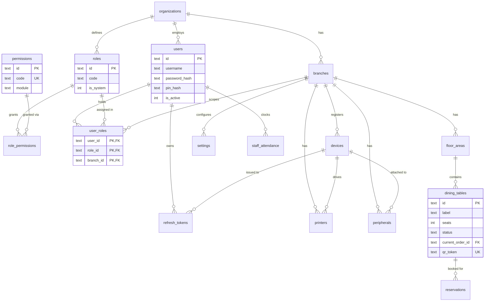
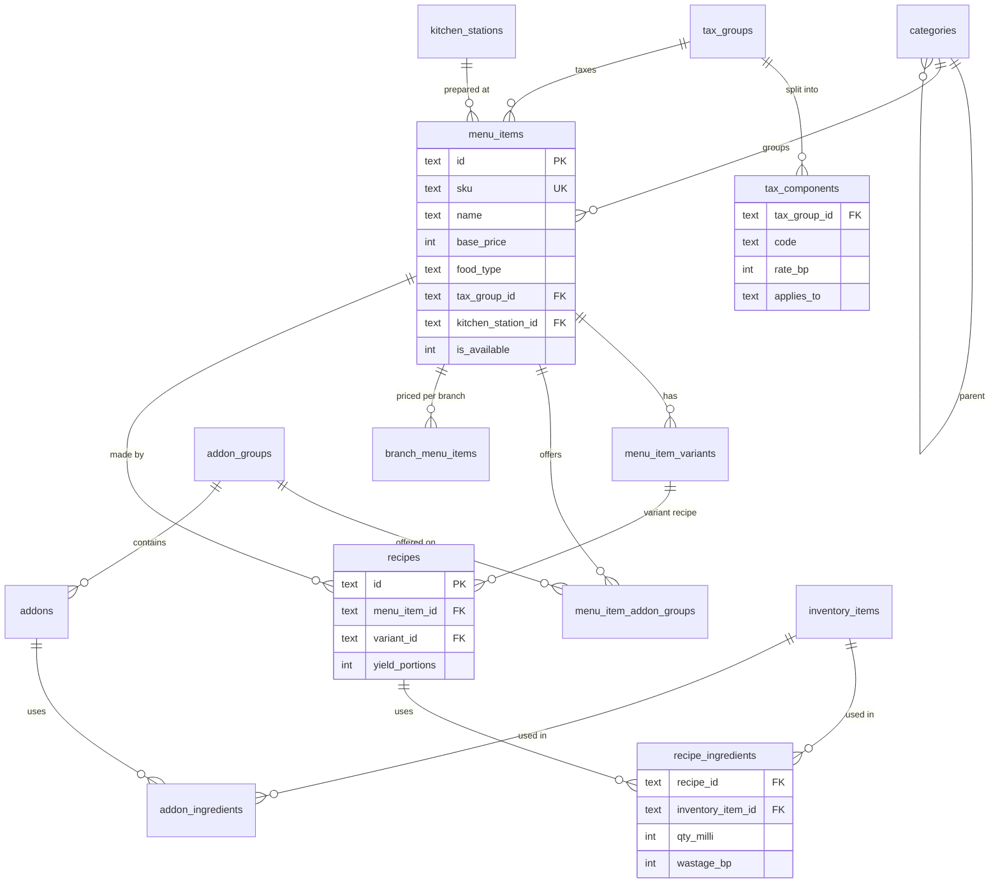
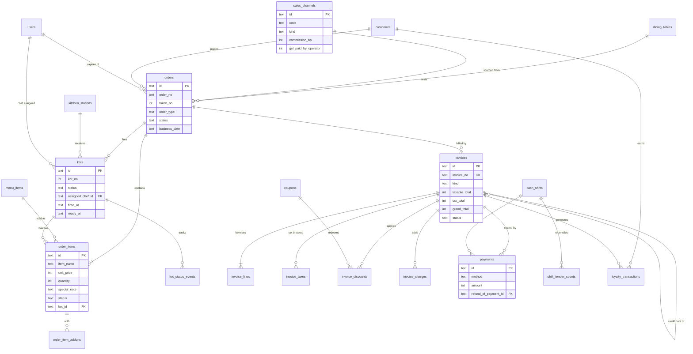
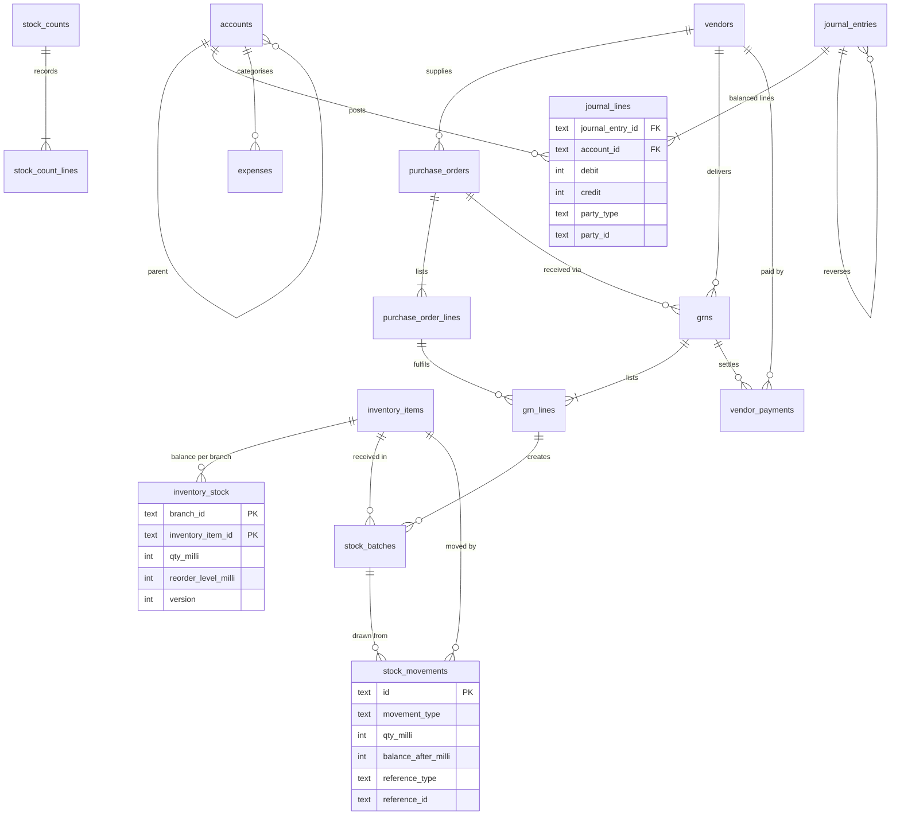
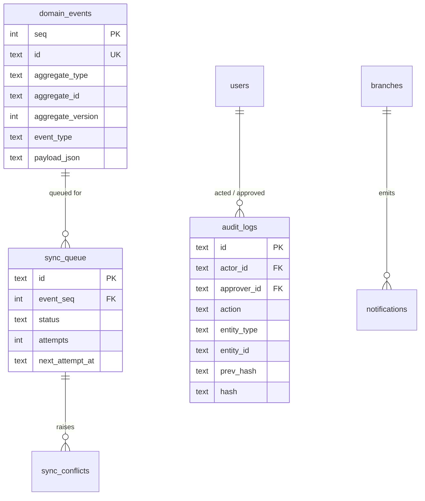

# 04 — ER Diagrams

Mermaid ERDs render on GitHub. Split per context for readability; audit columns (`created_*`, `updated_*`, `deleted_*`, `version`) are omitted.

## 4.1 Identity, organisation, floor

## 4.2 Catalog and recipes

## 4.3 Ordering, kitchen, billing, CRM

## 4.4 Inventory, purchasing, accounting

## 4.5 Platform (audit, events, sync)

