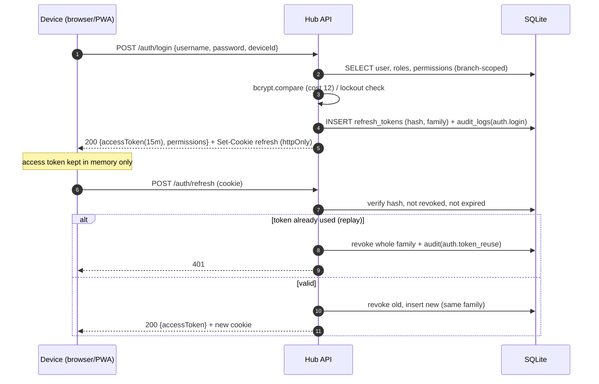
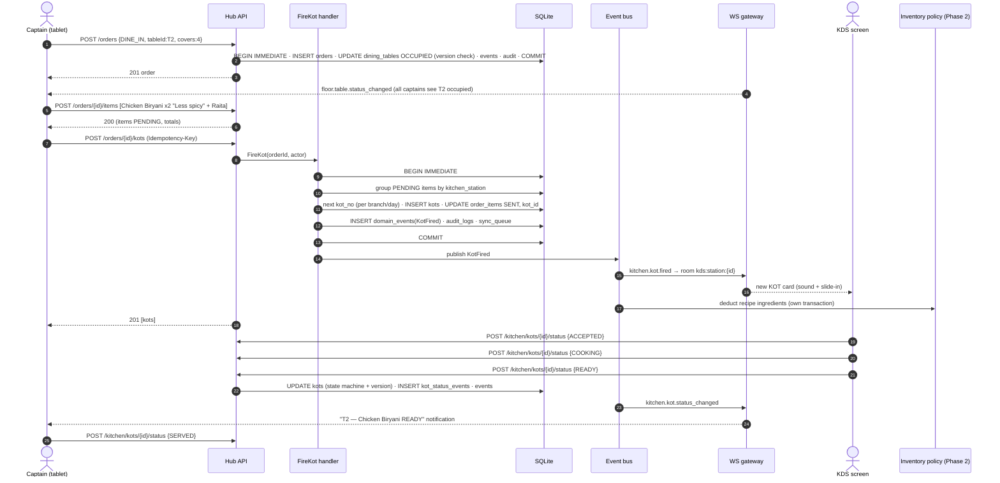
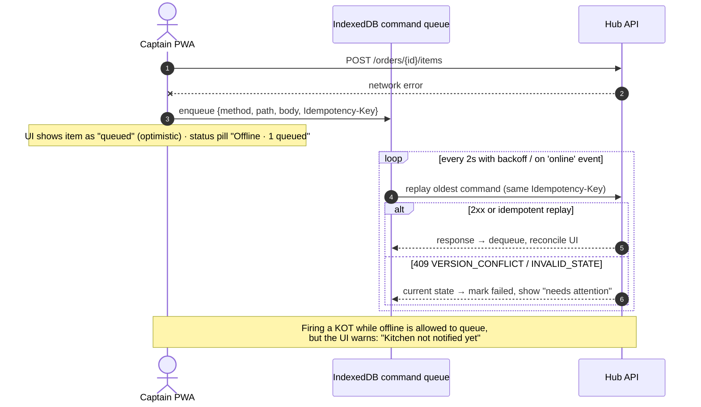
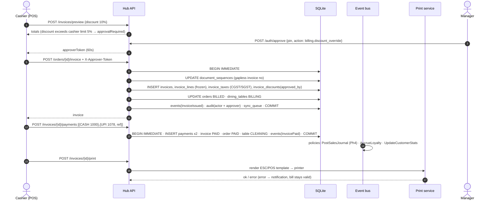
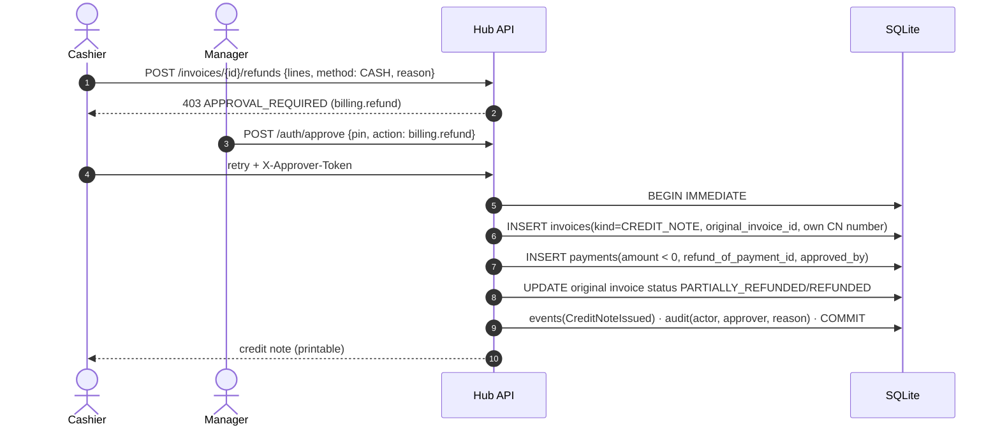
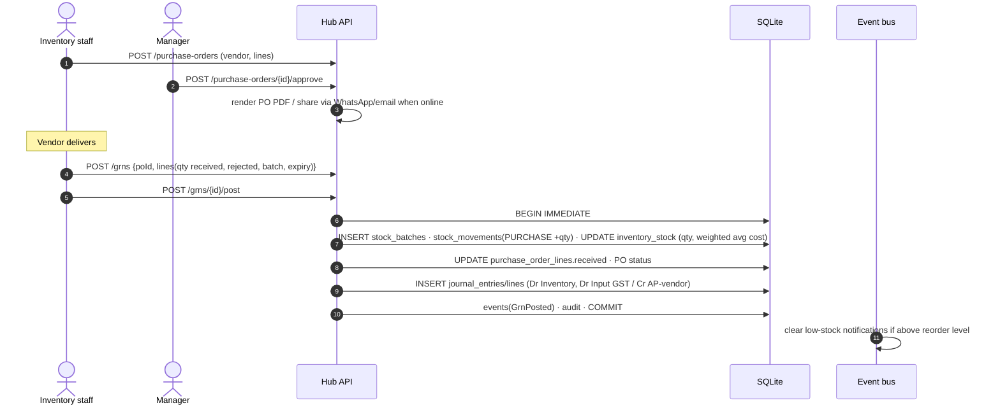
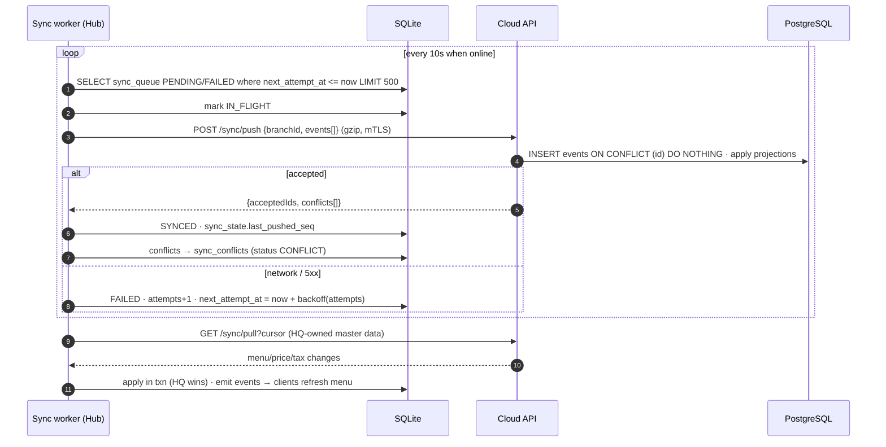

# 07 — Sequence Diagrams

## 7.1 Login and token refresh

## 7.2 Captain takes order → KOT → Kitchen (core flow)

## 7.3 Offline captain tablet (Wi-Fi drop)

## 7.4 Billing with split payment

## 7.5 Refund (credit note)

## 7.6 Purchase → GRN → Inventory → Accounts (Phase 3/4)

## 7.7 Cloud sync push (Phase 6)

