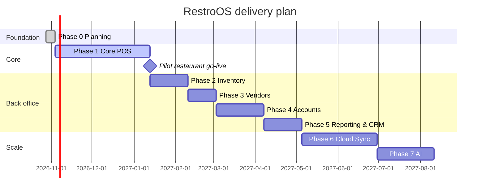

# 08 — Development Roadmap

Durations assume a team of 2–3 full-stack engineers and 1 QA. Every phase ends with a **shippable, installable build** that a pilot restaurant can use.

| Phase | Scope | Duration | Exit criteria |
|---|---|---|---|
| **0 · Planning** (this PR) | Architecture, schema, API, wireframes, sequences, roadmap | 1 wk | Docs reviewed; open questions in `01-architecture.md §8` answered |
| **1 · Core POS** | Login/RBAC, setup wizard, menu, floor/tables, captain ordering, KOT + KDS, billing (GST), payments incl. split, discounts with approval, refunds/credit notes, thermal printing, cash shifts, day-end report, audit log, backups, LAN pairing, token display | 8–10 wks | Pilot restaurant runs a full service day with zero data loss; p95 API < 100 ms on target hardware |
| **2 · Inventory** | Inventory items, recipes, auto-consumption on KOT, wastage, opening/closing counts, batches + expiry, low/overstock alerts | 4 wks | Theoretical vs. actual consumption variance report < 5% on pilot |
| **3 · Vendors** | Vendors, PO → approval → GRN → stock update, vendor payments, dues ageing | 3 wks | Full purchase cycle with auto stock update |
| **4 · Accounts** | Chart of accounts, auto-journals (sales, purchase, payment, COGS, expenses), ledgers, P&L, balance sheet, cash flow, GST reports (GSTR-1/3B summaries) | 5 wks | Trial balance always balances; accountant sign-off on sample month |
| **5 · Reporting & CRM** | Report engine (daily/weekly/monthly/annual), PDF/XLSX/CSV export, scheduled reports, customer history, favourites, LTV, loyalty points, membership tiers, QR self-ordering GA | 4 wks | All reports listed in the brief available + exportable |
| **6 · Cloud Sync & Multi-branch** | Sync worker, cloud API (PostgreSQL), head-office dashboard, central menu management, conflict UI, standby Hub fail-over | 6–8 wks | 2 branches sync for 2 weeks with zero lost events; fail-over drill < 5 min |
| **7 · AI** | Demand forecasting, inventory reorder prediction, revenue analytics, customer segmentation, recommendations | 6 wks+ | Forecast MAPE target agreed with pilot |

## Cross-phase tracks (continuous)

- **Quality**: unit tests on domain ≥ 90% line coverage; integration tests for every command; Playwright E2E for the 5 golden paths (order→KOT→bill, split pay, refund, offline captain, day-end).
- **Performance**: k6 load test in CI on every release: 100 virtual users, 10 orders/s for 30 min, p95 < 500 ms.
- **Security**: dependency audit, OWASP ASVS L2 checklist each phase, penetration test before Phase 6 GA.
- **Packaging**: Windows (NSIS, x64) and Linux (AppImage + .deb), code-signed, with delta auto-updates and a staged rollout ring.

## Milestones

